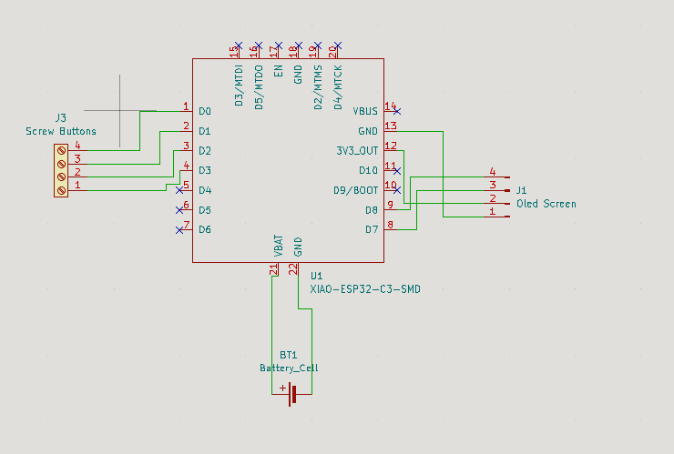
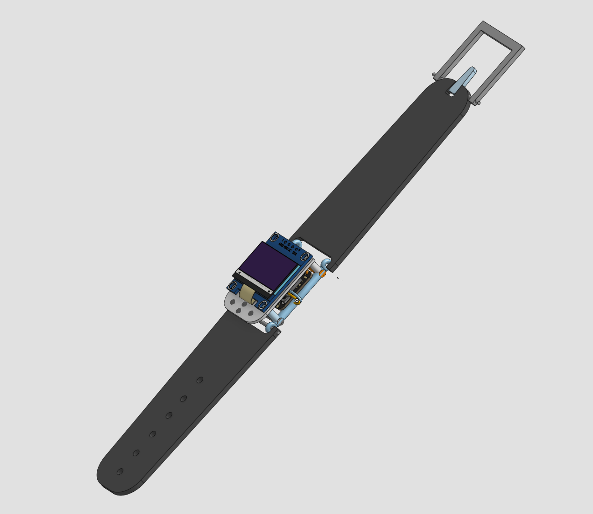
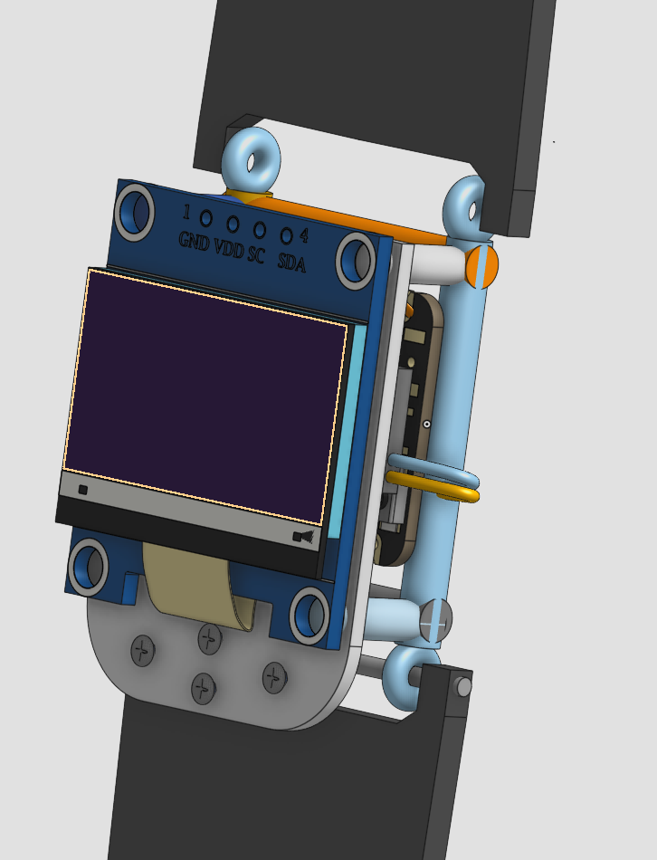

# Gaming-Watch

## Introduction:

This is a gaming watch I made for the week 4 of the Half Life challenge organized by Hackclub. 
With only three electronic components it is very simple.

## Build description:

I tried to keep the watch as compact as possible. 
To further reduce production cost I implemented capacitive touch keys with bolts instead of using regular buttons. 
I won't be 3D printing any parts. The 3D model is also here as blueprint, so I have an idea of how to build the watch. 

## Firmware:

The firmware is simple for now but will definitetly get updated in the future. 
It creates a simple menu. From this menu you can the start the only available game: Pong.
I made the code very modular and open for further changes like adding new games. 

## Schematic picture:

## Pictures of a 3D model of the watch:

## What I learned:

This project really taught me to believe in my skills. It is my first project that I made for Half Life without following the tutorials. 

